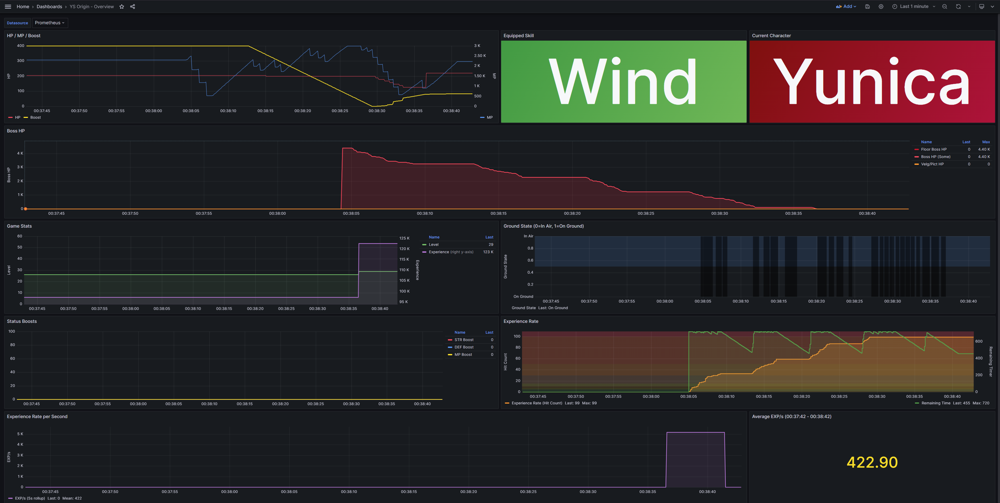

# YSO-Exporter

Ys Origin 用の Prometheus Metrics Exporter。  
ゲームメモリからリアルタイムでゲーム状態を収集し、Grafana での可視化のために Prometheus 形式でエクスポートします。

## 機能

- Ys Origin のゲームメモリからリアルタイムメトリクス収集
- Prometheus 互換のメトリクスエンドポイント
- モニタリング用ヘルスチェックエンドポイント
- Prometheus と Grafana を含む Docker Compose セットアップ
- 複数のゲームバージョンサポート（組み込み設定）
- ポーリング間隔の設定可能
- 自動プロセス監視と再接続

## サポートするゲームバージョン

### Ys Origin
- 日本語版 v1.1.0.3 (`jp_1.1.0.3`)
- 日本語版 v1.0.0.4 (`jp_1.0.0.4`)

### Ys VI: The Ark of Napishtim
- 日本語版 v1.3.1.0 (`ys6_jp_1.3.1.0`)

## クイックスタート

### 前提条件

- Windows 10/11
- Ys Origin (日本語版)
- Docker Desktop (オプション、Prometheus/Grafana用)
- Go 1.27+ (ソースからビルドする場合)

### インストール

#### ビルド済みバイナリを使用

1. リリースページから最新版をダウンロード
2. 任意のディレクトリに展開
3. エクスポーターを実行:

```bash
yso-exporter.exe
```

#### ソースからビルド

```bash
# リポジトリをクローン
git clone https://github.com/na2na/yso-exporter.git
cd yso-exporter

# バイナリをビルド
go build -o yso-exporter.exe ./cmd/yso-exporter

# エクスポーターを実行
./yso-exporter.exe
```

### 使用方法

#### 基本的な使い方

エクスポーターを起動（バージョン選択は対話式）:

```bash
yso-exporter.exe
```

特定バージョンを指定して起動:

```bash
yso-exporter.exe --version jp_1.1.0.3
```

これにより:
- 指定されたバージョンのゲームを監視
- ポート 8080 でメトリクスをエクスポート
- 100ms ごとにゲームメモリをポーリング

#### コマンドラインオプション

```bash
yso-exporter.exe [options]

オプション:
  -help
        ヘルプメッセージを表示
  -version string
        監視するゲームバージョン (未指定時は対話式選択)
  -port int
        メトリクスエンドポイント用HTTPサーバーポート (デフォルト 8080)
  -interval duration
        メモリ読み取りのポーリング間隔 (デフォルト 100ms)
  -list-versions
        利用可能なゲームバージョンを一覧表示
```

#### 使用例

```bash
# 利用可能なゲームバージョンを一覧表示
yso-exporter.exe --list-versions

# 特定バージョンで起動
yso-exporter.exe --version jp_1.0.0.4

# 別のポートを使用
yso-exporter.exe --port 9090

# ポーリング間隔を50msに変更
yso-exporter.exe --interval 50ms
```

## メトリクス

エクスポーターは現在以下のメトリクスを提供しています:

### Ys Origin (`jp_1.1.0.3` / `jp_1.0.0.4`)

#### プレイヤーステータス
- `yso_character` - 現在のキャラクター (0=Yunica, 1=Hugo, 2=Toal)
- `yso_level` - キャラクターレベル
- `yso_exp` - 経験値
- `yso_hp` - 現在のHP
- `yso_mp` - 現在のMP
- `yso_on_ground` - 地面接地状態 (0=空中, 非0=地面)
- `yso_boost` - ブーストゲージ
- `yso_equipped_skill` - 装備中のスキル (116=Wind, 117=Thunder, 118=Fire, 255=None)

#### ボス戦闘メトリクス
- `yso_boss_hp_floor` - フロアボスのHP
- `yso_boss_hp` - ボスHP (汎用)
- `yso_boss_hp_velg_pict` - ベルガー/ピクティモスのHP

#### ステータスブースト（秘薬）
- `yso_str_boost` - STRブースト値
- `yso_def_boost` - DEFブースト値
- `yso_mp_boost` - MPブースト倍率
- `yso_str_boost_time` - STRブースト残り時間
- `yso_def_boost_time` - DEFブースト残り時間
- `yso_mp_boost_time` - MPブースト残り時間

#### 経験値レート
- `yso_exp_rate` - ヒットカウント（経験値ブースト）
- `yso_exp_rate_time` - 経験値レート残り時間（最大720）

### Ys VI: The Ark of Napishtim (`ys6_jp_1.3.1.0`)

`ys6_loaded` は、プレイヤー構造体のロード状態を示す 0/1 のメトリクスです。
`ys6_loaded` が 0 の場合(プレイヤー構造体が未ロード、または読み取りに失敗した場合)、
下記「プレイヤー構造体系メトリクス」は一切出力されません（欠損）。
一方、「常時収集メトリクス」は `ys6_loaded` の値に関係なく収集を試みます。

#### ロード状態
- `ys6_loaded` - プレイヤー構造体のロード状態 (0=未ロード, 1=ロード済み)

#### プレイヤー構造体系メトリクス（`ys6_loaded=1` の場合のみ出力）
- `ys6_room_id` - 現在の部屋ID (-1=未ロード, 0=マップ間中継)
- `ys6_level` - レベル
- `ys6_exp` - 経験値
- `ys6_sword_livart_level` - リヴァート(風/青)剣レベル
- `ys6_sword_brillante_level` - ブリランテ(炎/赤)剣レベル
- `ys6_sword_ericcil_level` - エリシール(雷)剣レベル
- `ys6_emel` - エメル保有数
- `ys6_armor` - 装備防具ID (-1=未装備)
- `ys6_shield` - 装備盾ID (-1=未装備)
- `ys6_game_mode` - ゲームモード (0=ストーリー, 1=タイムアタック)
- `ys6_equipped_sword` - 装備中の剣 (0=リヴァート(青), 1=ブリランテ(赤), 2=エリシール(雷))
- `ys6_sword_livart_gauge` - リヴァート剣魔法ゲージ (0〜3000、装備中の剣のみ自動回復)
- `ys6_sword_brillante_gauge` - ブリランテ剣魔法ゲージ (0〜3000、装備中の剣のみ自動回復)
- `ys6_sword_ericcil_gauge` - エリシール剣魔法ゲージ (0〜3000、装備中の剣のみ自動回復)

#### 常時収集メトリクス（ロード状態に関係なく収集を試みる）
- `ys6_hp` - 現在HP
- `ys6_hp_visual` - 表示上のHP
- `ys6_max_hp` - プレイヤー最大HP
- `ys6_mp_gauge` - MPゲージ(現在装備の剣)
- `ys6_boss_hp` - ボスHP（読み取り失敗時は0を出力）
- `ys6_boss_max_hp` - ボス最大HP（読み取り失敗時は0を出力）
- `ys6_position_x` - プレイヤーX座標
- `ys6_position_y` - プレイヤーY座標
- `ys6_position_z` - プレイヤーZ座標
- `ys6_on_ground` - 接地状態 (1=接地, 0=空中)

## モニタリングスタック

### Docker Compose を使用

プロジェクトには Prometheus と Grafana を含む完全なモニタリングスタックが含まれています:

```bash
# モニタリングスタックを起動
docker compose up -d

# サービスへのアクセス:
# - Prometheus: http://localhost:9090
# - Grafana: http://localhost:3000 (admin/admin)
# - YSO-Exporter: http://localhost:8080/metrics
```

### Grafana ダッシュボード

Ys Origin と Ys VI それぞれに専用のダッシュボードが用意されており、`grafana/dashboards/` 配下の JSON がファイルプロビジョニングで自動的に読み込まれます。

#### YS Origin - Overview (`grafana/dashboards/yso-overview.json`)



以下を可視化する事前設定されたダッシュボードが含まれています:
- キャラクターステータスと進行状況
- HP/MP/ブーストゲージのリアルタイム追跡
- 現在装備中のスキル表示
- 地面接地状態の可視化
- ボス戦闘メトリクス
- ステータスブースト（秘薬）効果
- 経験値レートとその残り時間（0でも常に表示）

ダッシュボード設定:
- 自動更新間隔: 500ms
- 時系列データの視覚化
- ボスHPの複数系統同時表示
- Status Boostsパネルの下限: 0

#### Ys VI - Overview (`grafana/dashboards/ys6-overview.json`)

Ys VI: The Ark of Napishtim (`ys6_*` メトリクス) 専用のダッシュボードです。以下を可視化します:
- HP / 最大HP / MPゲージのリアルタイム追跡
- 装備中の剣とゲームモード（ストーリー/タイムアタック）
- プレイヤー構造体のロード状態 (`ys6_loaded`)
- ボスHP（非戦闘時は0を表示）
- 剣魔法ゲージ（リヴァート/ブリランテ/エリシール、0〜3000）
- 接地状態（1=接地, 0=空中）
- 剣強化レベル（3剣それぞれ）
- レベル・経験値・経験値レート
- エメル保有数、プレイヤー座標、部屋ID遷移（ルート検証用）

ダッシュボード設定は YS Origin 用と同様（自動更新間隔500msなど）です。

## 開発

### プロジェクト構造

```
yso-exporter/
├── cmd/yso-exporter/       # エントリーポイント
├── internal/
│   ├── collector/           # メトリクス収集
│   ├── config/              # 組み込み設定管理
│   ├── errors/              # エラー処理
│   ├── exporter/            # Prometheusエクスポーター
│   ├── logging/             # ロギングユーティリティ
│   ├── memory/              # Windows メモリAPI
│   ├── process/             # プロセス監視
│   └── version/             # バージョン管理
├── test/                    # 統合テスト
├── grafana/                 # Grafanaダッシュボード
├── prometheus/              # Prometheus設定
└── docs/                    # ドキュメント
```

### 主要な設計原則

- **組み込み設定**: 外部設定ファイル不要、全ての設定はバイナリに組み込み
- **カプセル化**: 各モジュールは単一の責任を持つ
- **関心の分離**: 各レイヤーは明確に分離され、疎結合
- **テスト駆動開発**: 全てのコンポーネントにテストを実装

### テストの実行

```bash
# ユニットテスト
go test ./...

# カバレッジ付き
go test ./... -cover

# 特定パッケージのテスト
go test ./internal/collector -v
```

### 新しいメトリクスの追加

1. `internal/config/builtin_configs.go` にアドレス設定を追加
2. `internal/collector/basic_collector.go` の収集リストにメトリクス名を追加
3. `mapMetricName()` 関数にマッピングを追加
4. 必要に応じてGrafanaダッシュボードを更新

### 新しいゲームバージョンの追加

1. `internal/config/builtin_configs.go` に新バージョンの設定を追加
2. CheatEngineなどでメモリアドレスを特定
3. テストを作成して動作確認

## トラブルシューティング

### ゲームが検出されない

- Ys Origin が実行中であることを確認
- プロセス名が設定と一致することを確認 (YSO_WIN.exe)
- 正しいゲームバージョンを選択していることを確認
- 必要に応じて管理者権限で実行

### "module YSO_WIN.exe not found" エラー

- ゲームが起動していない初期状態では正常な動作
- ゲーム起動後、自動的に接続されます
- "Process found: YSO_WIN.exe" のログを確認

### メトリクスが更新されない

- ヘルスエンドポイントを確認: `http://localhost:8080/health`
- プロセス接続状態を確認
- メモリ読み取りエラーのログを確認
- ゲームバージョンが正しいことを確認

### Docker の問題

- Docker Desktop が実行中であることを確認
- ポートの可用性を確認 (8080, 9090, 3000)
- `docker network ls` でネットワーク接続を確認

### Grafana ダッシュボードの問題

- 自動更新間隔が500msに設定されていることを確認
- Prometheus のスクレイプ間隔が100msに設定されていることを確認
- ブラウザのキャッシュをクリア
- Grafana を再起動: `docker restart yso-grafana`

## 技術詳細

### メモリ読み取り

- Windows API (ReadProcessMemory) を使用
- ポインタチェイン解決に対応
- 読み取り専用アクセス（ゲームに影響なし）

### アドレス設定形式

```go
"metric_name": {
    Base:        "YSO_WIN.exe+2F8314",  // モジュール相対アドレス
    Offsets:     []uint32{0x10, 0x20},  // ポインタチェイン
    Type:        "byte",                 // データ型
    Description: "説明",
}
```

サポートするデータ型:
- `byte`: 1バイト整数
- `int32`: 4バイト整数
- `float32`: 4バイト浮動小数点

### Docker Compose 環境変数

`compose.yml` で直接設定:
- Grafana 管理者認証情報
- 最小更新間隔 (10ms)
- Prometheus スクレイプ間隔 (100ms)
